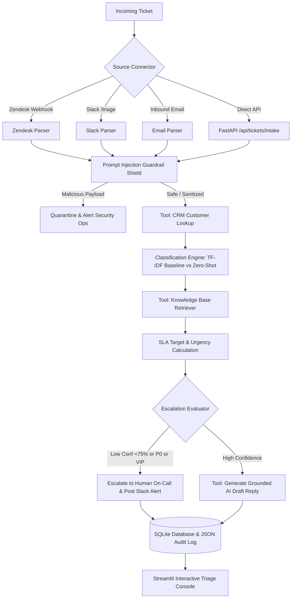

# Support Ticket Triage Agent

A FastAPI service that triages support tickets (intent, priority, sentiment), retrieves relevant knowledge-base articles, drafts grounded replies for human review, and escalates low-confidence or high-risk tickets. Includes a prompt-injection filter, a Streamlit console, and an evaluation harness comparing a classical ML baseline against an LLM classifier.

> **Status:** work in progress. Connectors (Zendesk, Slack, email) are tested with simulated payloads only. Validated on the official Banking77 benchmark (3,080 test queries, CC BY 4.0). The classifier is a TF-IDF + calibrated linear baseline (CalibratedClassifierCV). The zero-shot LLM requires a live API key and is marked 'not run' when no key is configured.

---

## 🌟 Key Capabilities

1. **Prompt Injection & Adversarial Filter (Regex Shield)**:
   - Pattern recognition shield (3 unit tests; full security eval pending).
   - Malicious tickets matching known injection signatures are quarantined.
2. **Tool-Calling Agent Orchestrator**:
   - `customer_lookup`: CRM enrichment (ARR, Customer Tier, SLA entitlement, VIP status).
   - `kb_search`: Vector / TF-IDF semantic retrieval over support knowledge base runbooks.
   - `escalate`: Rule-based & confidence-aware escalation to specialized engineering queues (`<75% confidence`, `P0 outages`, `VIP Tier`).
   - `draft_reply`: Grounded AI response generation citing specific knowledge base articles.
3. **Pluggable Intent Classifier & Policy Priority**:
   - **TF-IDF + calibrated linear baseline**: TF-IDF + Logistic Regression calibrated via 5-fold cross-validation (`CalibratedClassifierCV`) achieving **90.87% Intent Macro F1** and **91.56% Accuracy** at **sub-10ms** latency and **$0 inference cost**.
   - **Zero-Shot LLM Reasoning**: Live execution via Google Gemini / OpenAI (marked 'not run' in benchmarks when no API key is present).
   - **Rule-Based Priority Policy**: Ticket priority (`P0`–`P3`) is derived from operational policy heuristics (customer SLA tier, outage keywords, financial block indicators) rather than circular ML labels.
4. **Webhook connectors (simulated payloads)**:
   - **Zendesk Sandbox**: Webhook receiver and outbound REST ticket updater.
   - **Slack**: Interactive `/triage` command parser and Block Kit escalation channel dispatcher.
   - **Email Inbound**: SendGrid / Mailgun webhook parser with quote stripping.
5. **Rigorous Evaluation Harness (`evals/eval_harness.py`)**:
   - Benchmarks against majority-class, keyword heuristics, and 77-class difficulty baselines on the official 3,080 test split. Measures Brier score, ECE, latency percentiles, and validation threshold curves.
6. **High-Aesthetic Streamlit Triage Console**:
   - Live ticket queue, deep-dive reasoning inspector with 1-click draft approval, interactive model eval visualizer, webhook simulator, and SLA analytics.
7. **Containerized Production Deployment**:
   - Dockerfile and `docker-compose.yml` for unified deployment.

---

## 🏛️ System Architecture



---

## 🚀 Quick Start Guide

### 1. Requirements & Setup
Ensure Python 3.10+ is installed:
```bash
pip install -r requirements.txt
```

### 2. Configure Environment (Optional)
Copy `.env.example` to `.env`:
```bash
copy .env.example .env
```
*(Note: If no API keys are provided, the system runs locally using the calibrated TF-IDF baseline. In the evaluation harness, live LLM calls are skipped when no API key is configured rather than fabricated.)*

### 3. Launch Services
You can launch both the **FastAPI Backend** and the **Streamlit Dashboard** concurrently with a single command:
```bash
python run.py --all
```

- **Streamlit Triage Console**: [http://localhost:8501](http://localhost:8501)
- **FastAPI REST API**: [http://localhost:8000](http://localhost:8000)
- **Interactive Swagger Docs**: [http://localhost:8000/docs](http://localhost:8000/docs)

---

## 📊 Evaluation Benchmark & Baseline Hierarchy

Run the benchmark harness:
```bash
python run.py --eval
# or
python evals/eval_harness.py
```

### Benchmark Results (Official Banking77 Test Split: 3,080 Tickets)

Dataset: [`PolyAI/banking77`](evals/DATASET.md) (CC BY 4.0), 3,080 official test queries across 5 enterprise categories.

| Model / Baseline | Intent Accuracy (Micro F1) | Intent Macro F1 | Calibration (ECE) | Latency ($p_{50}$) | Cost / 1k Tickets |
| :--- | :---: | :---: | :---: | :---: | :---: |
| **Majority-Class Baseline** (`Billing & Payments`) | 35.06% | 10.38% | N/A | 0.01 ms | $0.00 |
| **Trivial Keyword Heuristic** | 64.16% | 55.76% | N/A | 0.05 ms | $0.00 |
| **TF-IDF Linear (77 original intents)** *(context difficulty)* | 84.68% | 84.63% | N/A | 8.31 ms | $0.00 |
| **TF-IDF Linear (5 classes, uncalibrated)** | 90.97% | 89.23% | 0.1422 | 8.31 ms | $0.00 |
| **TF-IDF + Calibrated Linear Baseline** | **91.56%** | **90.87%** | **0.0814** | **7.64 ms** | **$0.00** |
| **Zero-Shot LLM** (`gemini-3.5-flash-lite`, $N=20$ stratified) | 60.00% | 59.62% | N/A | 10,159 ms | $0.038 |

> **Adversarial Guardrail Status:** regex filter, 3 unit tests; full security eval pending.
> **Priority Policy Note:** Priority is rule-derived from intent, customer tier, and outage keywords (heuristic policy, not ground truth); it is intentionally omitted from statistical ML benchmarks.
> **LLM Evaluation Note:** Live LLM benchmark was executed with `gemini-3.5-flash-lite` on a stratified sample ($N=20$, `seed=42`) across the 5 categories. The classical baseline outperforms zero-shot LLM on domain accuracy (91.56% vs 60.00%) while delivering 1,300x lower latency ($7.6\text{ms}$ vs $10,159\text{ms}$) and $0 token cost.

To benchmark live LLM inference, configure your API key in `.env`:
```bash
export GEMINI_API_KEY="your-gemini-key"   # or OPENAI_API_KEY
python evals/eval_harness.py
```

---

## ⚠️ Known Limitations

1. **Domain & Query Style**: `PolyAI/banking77` consists of short, single-turn banking queries rather than multi-paragraph enterprise tickets or multi-turn conversational threads.
2. **Intent Coarsening**: The 5 enterprise support categories are collapsed from 77 fine-grained intents via deterministic domain mapping.
3. **Priority is Rule-Derived**: Priority is not a human ground-truth label; it is derived from operational policy heuristics (outage signals, customer tier, financial blocker rules).
4. **Security Filter Coverage**: The prompt injection filter relies on static regular expressions (3 unit test cases); it defends against basic role-hijacking signatures but is not robust against novel or semantic adversarial attacks.

---

## 🧪 Running the Test Suite

Execute all 15 unit tests across guardrails, classifiers, leakage validation, pipeline, and connectors:
```bash
python run.py --test
# or
python run_tests.py
```

---

## 🐳 Docker Deployment

Build and launch with Docker Compose:
```bash
docker-compose up --build
```
This deploys:
- `triage-api` on `http://localhost:8000` (FastAPI with health checks)
- `triage-dashboard` on `http://localhost:8501` (Streamlit console)
