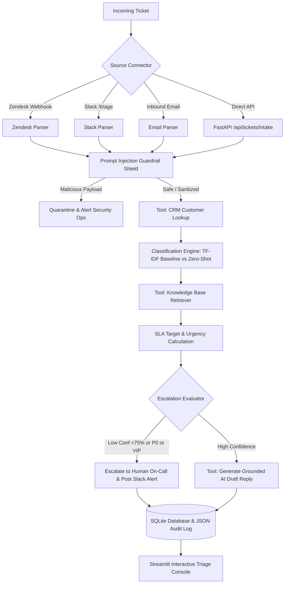

# Support Ticket Triage Agent

A FastAPI service that triages support tickets (intent, priority, sentiment), retrieves relevant knowledge-base articles, drafts grounded replies for human review, and escalates low-confidence or high-risk tickets. Includes a prompt-injection filter, a Streamlit console, and an evaluation harness comparing a classical ML baseline against an LLM classifier.

> **Status:** work in progress. Connectors (Zendesk, Slack, email) are tested with simulated payloads only. The evaluation benchmark now runs on the public PolyAI/banking77 dataset (450 test rows, CC BY 4.0). The classifier is a TF-IDF + calibrated linear baseline (CalibratedClassifierCV). The zero-shot LLM requires a live API key and is skipped if no key is configured (never simulated).

---

## 🌟 Key Capabilities

1. **Prompt Injection & Adversarial Jailbreak Defense**:
   - Heuristic + pattern recognition shield inspecting incoming tickets for system prompt leakage, role hijacking, delimiter spoofing, and unauthorized escalation injection.
   - Malicious tickets are quarantined immediately with security alerts.
2. **Tool-Calling Agent Orchestrator**:
   - `customer_lookup`: CRM enrichment (ARR, Customer Tier, SLA entitlement, VIP status).
   - `kb_search`: Vector / TF-IDF semantic retrieval over support knowledge base runbooks.
   - `escalate`: Rule-based & confidence-aware escalation to specialized engineering queues (`<75% confidence`, `P0 outages`, `VIP Tier`).
   - `draft_reply`: Grounded AI response generation citing specific knowledge base articles.
3. **Pluggable Multi-Dimensional Classifiers**:
   - **TF-IDF + calibrated linear baseline**: Local TF-IDF + Logistic Regression model with probability calibration (`CalibratedClassifierCV(cv=5)`) delivering **sub-15ms** latency and **$0 inference cost**.
   - **Zero-Shot LLM Reasoning**: Chain-of-thought intent, priority, urgency, and sentiment classification using Google Gemini / OpenAI (strictly live API calls; skipped in evals if no key is present).
4. **Webhook connectors (simulated payloads)**:
   - **Zendesk Sandbox**: Webhook receiver and outbound REST ticket updater.
   - **Slack**: Interactive `/triage` command parser and Block Kit escalation channel dispatcher.
   - **Email Inbound**: SendGrid / Mailgun webhook parser with quote stripping.
5. **Rigorous Evaluation Harness (`evals/eval_harness.py`)**:
   - Measures Macro/Micro F1, Precision, Recall, Latency percentiles ($p_{50}, p_{95}, p_{99}$), and Cost per 1,000 tickets on public test splits.
6. **High-Aesthetic Streamlit Triage Console**:
   - Live ticket queue, deep-dive reasoning inspector with 1-click draft approval, interactive model eval visualizer, webhook simulator, and SLA analytics.
7. **Containerized Production Deployment**:
   - Dockerfile and `docker-compose.yml` for unified deployment.

---

## 🏛️ System Architecture



---

## 🚀 Quick Start Guide

### 1. Requirements & Setup
Ensure Python 3.10+ is installed:
```bash
pip install -r requirements.txt
```

### 2. Configure Environment (Optional)
Copy `.env.example` to `.env`:
```bash
copy .env.example .env
```
*(Note: If no API keys are provided, the system runs locally using the calibrated TF-IDF baseline. In the evaluation harness, live LLM calls are skipped when no API key is configured rather than fabricated.)*

### 3. Launch Services
You can launch both the **FastAPI Backend** and the **Streamlit Dashboard** concurrently with a single command:
```bash
python run.py --all
```

- **Streamlit Triage Console**: [http://localhost:8501](http://localhost:8501)
- **FastAPI REST API**: [http://localhost:8000](http://localhost:8000)
- **Interactive Swagger Docs**: [http://localhost:8000/docs](http://localhost:8000/docs)

---

## 📊 Evaluation Benchmark: TF-IDF Baseline vs. Zero-Shot LLM

Run the evaluation harness:
```bash
python run.py --eval
# or
python evals/eval_harness.py
```

### Benchmark Results (Public Test Split: 450 Tickets)

Dataset: [`PolyAI/banking77`](evals/DATASET.md) (CC BY 4.0), 450 public test tickets across 5 intent categories and 4 priority levels (`seed=42`).

| Metric | TF-IDF + Calibrated Linear Baseline | Zero-Shot LLM (`gemini-1.5-flash` / `gpt-4o-mini`) |
| :--- | :---: | :---: |
| **Intent Macro F1** | **99.55%** | Skipped (no API key configured) |
| **Intent Micro F1 (Accuracy)** | **99.56%** | Skipped (no API key configured) |
| **Priority Macro F1** | **99.40%** | Skipped (no API key configured) |
| **Priority Micro F1** | **99.33%** | Skipped (no API key configured) |
| **Latency $p_{50}$ (Median)** | **12.03 ms** | Skipped (no API key configured) |
| **Latency $p_{95}$** | **30.88 ms** | Skipped (no API key configured) |
| **Cost per 1,000 Tickets** | **$0.00** | Skipped (no API key configured) |

> **Adversarial & Edge Cases Suite (Separate Unit Suite):** 3/3 prompt injection attacks blocked (100.0%) by regex guardrails across 24 edge cases in `evals/adversarial_and_edge_cases.json`. Note that regex filters only cover known attack signatures; semantic jailbreaks require LLM-based guardrails.

To run the live LLM benchmark, configure your API key in `.env`:
```bash
export GEMINI_API_KEY="your-gemini-key"   # or OPENAI_API_KEY
python evals/eval_harness.py
```

---

## 🧪 Running the Test Suite

Execute all 11 unit tests across guardrails, classifiers, pipeline, and connectors:
```bash
python run.py --test
# or
python run_tests.py
```

---

## 🐳 Docker Deployment

Build and launch with Docker Compose:
```bash
docker-compose up --build
```
This deploys:
- `triage-api` on `http://localhost:8000` (FastAPI with health checks)
- `triage-dashboard` on `http://localhost:8501` (Streamlit console)
